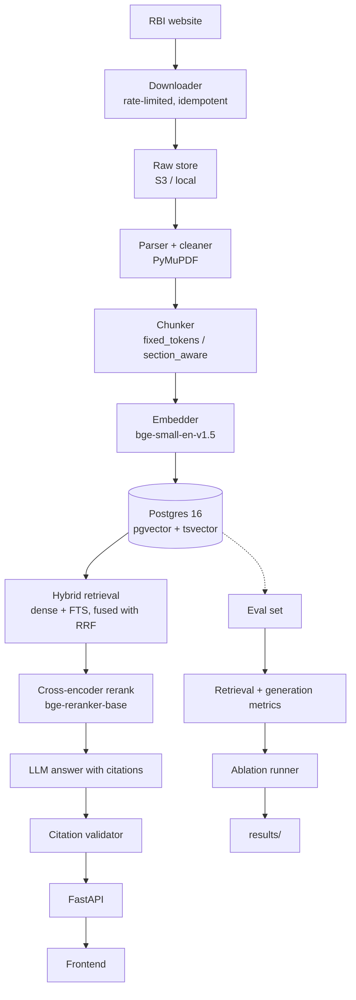

# rbi-rag

Question answering over public **RBI Master Directions**, returning answers with
verifiable citations — circular number, page, and source URL — backed by a
reproducible evaluation suite and an ablation study.

> **Status: Phase 6 of 7 (frontend and AWS).** The full path works, the
> evaluation suite is built, CI blocks a merge when retrieval regresses,
> and there is a frontend plus Terraform for a free-tier deployment.
> **There are no quality results yet**, because those need a downloaded
> corpus and a human-verified eval set. Every number in this README will
> come from a script in this repository; none are written by hand.

**Live demo:** TODO — deploy with `infra/` and put the URL here.

---

## Why this exists

RBI Master Directions are long, amended often, and cross-reference each other.
A plausible-sounding answer is worthless if you cannot check it, so every claim
this system makes is tied to a specific page of a specific circular. The
evaluation suite exists to measure whether that actually holds, and the ablation
study exists to show which design choices earned their keep.

## Architecture



## Results

TODO — populated by `uv run poe eval` from Phase 4 onward. Until then this
section stays empty rather than holding placeholder numbers.

## Getting started

Requires Windows with PowerShell, [uv](https://docs.astral.sh/uv/), and Docker
Desktop with the WSL2 backend.

```powershell
# 1. Install dependencies
uv sync

# 2. Create your local config
Copy-Item .env.example .env
# then open .env and set ANTHROPIC_API_KEY

# 3. Start Postgres + pgvector
uv run poe db-up

# 4. Check everything is wired up
uv run poe lint
uv run poe test
```

Install the git hooks once:

```powershell
uv run pre-commit install
```

The embedding and reranker models are only needed from Phase 1 onward and are
kept out of the default install because they pull in torch:

```powershell
uv sync --extra ml
```

## Tasks

| Task | What it does | Available from |
| --- | --- | --- |
| `uv run poe lint` | ruff check, ruff format --check, mypy strict on `src/` | now |
| `uv run poe fmt` | auto-fix and format | now |
| `uv run poe test` | pytest | now |
| `uv run poe db-up` / `db-down` / `db-nuke` / `db-logs` | manage Postgres | now |
| `uv run poe ingest harvest` | fetch the RBI listing, update the manifest | now |
| `uv run poe ingest urls` | list PDFs still to download | now |
| `uv run poe ingest status` | hash the raw store, report what is missing | now |
| `uv run poe ingest process` | parse, clean and chunk what is present | now |
| `uv run poe index build` | embed a chunk set and index it | now |
| `uv run poe index sets` | list chunk sets in the database | now |
| `uv run poe query "..."` | print ranked chunks with scores | now |
| `uv run poe serve` | run the API | now |
| `uv run poe eval status` | what the eval set contains | now |
| `uv run poe eval review` | verify candidate questions yourself | now |
| `uv run poe eval retrieval` | sweep all 36 arms, no LLM, free | now |
| `uv run poe eval` | retrieval, then generation, then results tables | now |

Tasks whose phase has not landed exit with status 2 and say so.

## Ingestion

Ingestion is **harvest → acquire → process**. The three stages are separate
because they fail for different reasons and resume differently.

**1. Harvest** — one rate-limited request to rbi.org.in, then a list of what
still needs downloading.

```powershell
uv run poe ingest harvest   # -> data/manifest.jsonl
uv run poe ingest urls      # -> data/pdf_urls.txt
```

**2. Acquire — this stage is manual.** RBI serves its PDFs behind a JavaScript
bot challenge, so a script receives a challenge page rather than a file. This
project does not work around that. Open `data/pdf_urls.txt`, download the PDFs
through your browser, and save them into `data/raw/` keeping their original
filenames.

**3. Process** — hash what arrived, then parse, clean and chunk it.

```powershell
uv run poe ingest status
uv run poe ingest process
```

Re-running any step is a no-op when nothing has changed. `status` flags files
that are not really PDFs, which is what a saved bot-challenge page looks like.

To work on a subset while developing, `uv run poe ingest process --limit 20`.

## Retrieval

Build an index from a chunk set, then query it.

```powershell
uv run poe db-up            # Postgres + pgvector on port 5434
uv run poe index build      # embeds and indexes the default chunk set
uv run poe query "what is the minimum capital adequacy ratio"
```

Every retriever is selected by flag, and the output shows which first-stage
retriever found each chunk and at what rank:

```powershell
uv run poe query "..." --retriever dense     # vectors only
uv run poe query "..." --retriever fts       # Postgres full-text only
uv run poe query "..." --retriever hybrid    # both, fused with RRF
uv run poe query "..." --rerank              # add the cross-encoder
uv run poe query "..." --exact               # bypass HNSW, exact kNN
```

Embedding and reranking run on **onnxruntime**, not torch, so a normal install
is about 130 MB rather than 2.5 GB. The ONNX backend is checked against
sentence-transformers by `uv run poe test-parity`; see DECISIONS.md entry 0014
for the measured agreement.

## Answering

```powershell
Copy-Item .env.example .env   # then set ANTHROPIC_API_KEY
uv run poe serve
```

```powershell
curl.exe -s -X POST http://127.0.0.1:8000/query `
  -H "Content-Type: application/json" `
  -d '{\"question\":\"what is the minimum capital adequacy ratio\"}'
```

The response carries the answer, its citations, the chunk ids that were
retrieved, latency, token usage and `cost_usd`. `GET /health` reports each
dependency separately, so a missing key or an unreachable database says so
rather than surfacing later as a failed query.

**Two things the system will not do.** It will not return a citation whose
quote does not appear verbatim in the chunk it names — the answer is withheld
instead. And it will not answer from anything but the retrieved excerpts: when
they do not support an answer it abstains. See DECISIONS.md entries 0020-0021.

## Tests

```powershell
uv run poe test              # unit: no database, no network, no models
uv run poe test-integration  # needs `poe db-up`
uv run poe test-model        # downloads models from HuggingFace
uv run poe test-parity       # needs `uv sync --extra ml` (installs torch)
```

Only the first runs in CI.

## Evaluation

```powershell
uv run poe eval status       # what the eval set contains
uv run poe eval review       # verify candidates - only you can do this
uv run poe eval retrieval    # all 36 arms, no LLM, free
uv run poe eval              # retrieval, then generation on a subset
```

**Reported metrics use human-verified items only.** A drafting script proposes
candidate questions and always writes `verified_by_human=false`; nothing
automated can flip that flag. With no verified items the suite refuses to
report anything rather than scoring the system against questions it wrote
itself.

Gold evidence is labelled as **spans** — document, page range, quote — not as
chunk ids. Chunk ids encode their chunking configuration and share nothing
across configurations (measured: zero overlap between any two), so a chunk-id
gold set would be valid for one arm of the ablation and empty for the other
five. Recall counts spans found rather than chunks retrieved, so large chunks
do not score better merely by being fewer. See DECISIONS.md entries 0026-0027.

## The CI gate

Every push runs a retrieval regression check against a committed snapshot:

```powershell
uv run poe eval gate       # what CI runs
uv run poe eval snapshot --baseline-only   # re-record after an intended change
```

**The gate is a canary, not a measurement.** It runs on a fixture corpus with
fixture questions and answers one question: has retrieval changed since the
baseline was recorded? Its numbers are not a statement about quality and must
not be quoted as results.

It gates `recall@1`, `recall@5` and `mrr`. Recall alone is not enough: with a
snapshot smaller than k, every chunk is retrieved whatever the ranking, so
recall@k is pinned at 1.0. Inverting the dense retriever left recall@5 at
1.0000 while MRR fell to 0.25 — the order-sensitive metrics are what make the
gate bite. See DECISIONS.md entry 0033.

Query vectors are committed with the snapshot, so the job needs no model
download. It runs against real Postgres rather than the in-memory store,
because the two score keyword search differently and a gate measuring the fake
would measure the wrong thing.

## Frontend

`uv run poe serve`, then open <http://127.0.0.1:8000/>. One self-contained
HTML page: ask a question, read the answer, click a citation to open that page
of the source PDF, and see latency and `cost_usd` underneath. Abstention
renders as its own state rather than an empty answer.

## Deployment

```powershell
docker build -t rbi-rag:local .
```

`infra/` holds Terraform for a free-tier AWS shape — EC2 running the
container, RDS PostgreSQL with pgvector, S3 for the PDFs, least-privilege IAM
and a cost budget with alerts. Estimated **$0–1/month** inside the 12-month
free tier, about **$23/month** after. See [infra/README.md](infra/README.md)
for the commands and a teardown guide that covers what `terraform destroy`
leaves behind.

The configuration is validated (`terraform validate`) but **has never been
applied** — no AWS account was touched in writing it, and nothing in this
repository runs `apply`, `destroy`, or any mutating AWS command.

Reranking is **off** in the deployed image. Measured: the reranker needs
1.32 GB of RAM against the API's 242 MB without it, which is the difference
between a free-tier instance and a paid one. Phase 4's ablation has not yet
shown it helps, so it stays off until it does.

## Repository layout

See [CLAUDE.md](CLAUDE.md) for the full map and the conventions this project
holds itself to. Design tradeoffs are recorded in [DECISIONS.md](DECISIONS.md).

## Limitations

To be filled in honestly as the system is built and measured (Phase 7). Known
already:

- **PDF acquisition is manual.** RBI's document host answers scripted clients
  with a JavaScript bot challenge. This project does not circumvent it, so the
  PDFs are downloaded through a browser (see Ingestion above). Everything from
  `data/raw/` onward is automated and reproducible.
- **`robots.txt` could not be read.** RBI returns HTTP 418 for it to every
  scripted client tried. Per RFC 9309 a 4xx means no policy is published, so
  harvesting proceeds; each run prints that no policy was actually read. The
  two-second request floor applies regardless.
- **Chunks of 1024 tokens will be truncated when embedded.**
  `BAAI/bge-small-en-v1.5` accepts 512 tokens. The tokenizer does not enforce
  this (measured: 2,000 words encode to 2,000 tokens), so the truncation
  happens silently inside `sentence-transformers`. The Phase 4 ablation must
  report this next to any 1024-token result rather than presenting it as a
  clean chunk-size comparison.
- **The deployment has no TLS and no authentication.** The instance serves
  HTTP behind a CIDR allowlist. Opening it to the world would expose an
  endpoint that spends money per request.
- **The Terraform has never been applied.** It validates, but validation is
  not a deployment, and the first real `apply` will find things validation
  cannot.
- **The CI gate does not measure quality.** It detects change on a fixture
  corpus. It also cannot catch a regression inside the embedder, since it
  replays committed query vectors; `poe test-model` covers that.
- **There are no measured results.** The ablation runs, but it needs a real
  corpus and a verified eval set to produce anything worth reporting. The
  Results section stays empty until then.
- **Generation metrics are not deterministic.** Responses are cached by
  content hash so a re-run replays them; clearing the cache re-samples the
  model. Retrieval metrics reproduce exactly.
- **Faithfulness depends on an LLM judge.** It is reported next to Cohen's
  kappa against hand labels, and reads `TODO` until that subset is labelled.
- **Abstention has no tuned threshold yet.** The retrieval gate ships
  disabled, because a threshold chosen before Phase 4 supplies labelled
  unanswerable questions would be a number nobody measured. Abstention
  currently rests on the model's own judgement plus citation validation.
- **`ANTHROPIC_EFFORT` is untuned.** It defaults to `medium`; Phase 4
  should sweep it rather than leaving it to taste.
- **`cost_usd` comes from a price table dated in the code.** It is exact
  arithmetic over published rates, not a measurement of your bill, and it
  is `None` for any model not in the table rather than a guess.
- **Section detection falls back to a heuristic.** `section_aware` chunking
  prefers the PDF outline, but many RBI PDFs carry no bookmarks, in which case
  headings are detected by pattern matching.
- **Postgres full-text search is not BM25.** `ts_rank_cd` has no
  document-length normalisation of the kind BM25 applies and no tunable
  k1/b, so this arm is reported as "FTS" and never as BM25. The `english`
  configuration also stems with Snowball, which conflates regulatory terms a
  lawyer would distinguish. See DECISIONS.md entry 0015.
- **Recall is measured with exact search, not through HNSW.** An approximate
  index loses some recall of its own, and mixing that into a comparison
  between retrievers would make it indistinguishable from a real effect.
  HNSW serves queries; evaluation bypasses it. See DECISIONS.md entry 0016.
- Only public Master Directions are indexed. Amendments issued as separate
  circulars may not be reflected in the text of the parent Direction.

## License

TODO
