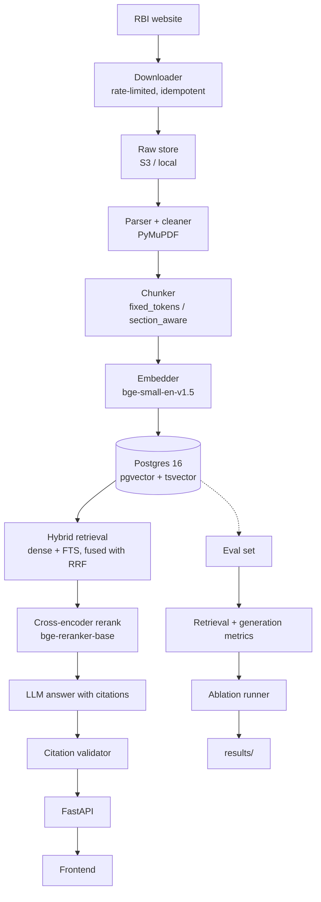

# rbi-rag

Question answering over public **RBI Master Directions**, returning answers with
verifiable citations — circular number, page, and source URL — backed by a
reproducible evaluation suite and an ablation study.

> **Status: Phase 1 of 7 (ingestion).** Metadata harvesting, PDF parsing,
> cleaning and chunking work. Nothing is indexed, retrieved or generated yet,
> and there are no results to report. Every number in this README will come
> from a script in this repository; none are written by hand.

**Live demo:** TODO (Phase 6)

---

## Why this exists

RBI Master Directions are long, amended often, and cross-reference each other.
A plausible-sounding answer is worthless if you cannot check it, so every claim
this system makes is tied to a specific page of a specific circular. The
evaluation suite exists to measure whether that actually holds, and the ablation
study exists to show which design choices earned their keep.

## Architecture



## Results

TODO — populated by `uv run poe eval` from Phase 4 onward. Until then this
section stays empty rather than holding placeholder numbers.

## Getting started

Requires Windows with PowerShell, [uv](https://docs.astral.sh/uv/), and Docker
Desktop with the WSL2 backend.

```powershell
# 1. Install dependencies
uv sync

# 2. Create your local config
Copy-Item .env.example .env
# then open .env and set ANTHROPIC_API_KEY

# 3. Start Postgres + pgvector
uv run poe db-up

# 4. Check everything is wired up
uv run poe lint
uv run poe test
```

Install the git hooks once:

```powershell
uv run pre-commit install
```

The embedding and reranker models are only needed from Phase 1 onward and are
kept out of the default install because they pull in torch:

```powershell
uv sync --extra ml
```

## Tasks

| Task | What it does | Available from |
| --- | --- | --- |
| `uv run poe lint` | ruff check, ruff format --check, mypy strict on `src/` | now |
| `uv run poe fmt` | auto-fix and format | now |
| `uv run poe test` | pytest | now |
| `uv run poe db-up` / `db-down` / `db-nuke` / `db-logs` | manage Postgres | now |
| `uv run poe ingest harvest` | fetch the RBI listing, update the manifest | now |
| `uv run poe ingest urls` | list PDFs still to download | now |
| `uv run poe ingest status` | hash the raw store, report what is missing | now |
| `uv run poe ingest process` | parse, clean and chunk what is present | now |
| `uv run poe query "..."` | print ranked chunks with scores | Phase 2 |
| `uv run poe serve` | run the API | Phase 3 |
| `uv run poe eval` | reproduce the results tables | Phase 4 |

Tasks whose phase has not landed exit with status 2 and say so.

## Ingestion

Ingestion is **harvest → acquire → process**. The three stages are separate
because they fail for different reasons and resume differently.

**1. Harvest** — one rate-limited request to rbi.org.in, then a list of what
still needs downloading.

```powershell
uv run poe ingest harvest   # -> data/manifest.jsonl
uv run poe ingest urls      # -> data/pdf_urls.txt
```

**2. Acquire — this stage is manual.** RBI serves its PDFs behind a JavaScript
bot challenge, so a script receives a challenge page rather than a file. This
project does not work around that. Open `data/pdf_urls.txt`, download the PDFs
through your browser, and save them into `data/raw/` keeping their original
filenames.

**3. Process** — hash what arrived, then parse, clean and chunk it.

```powershell
uv run poe ingest status
uv run poe ingest process
```

Re-running any step is a no-op when nothing has changed. `status` flags files
that are not really PDFs, which is what a saved bot-challenge page looks like.

To work on a subset while developing, `uv run poe ingest process --limit 20`.

## Repository layout

See [CLAUDE.md](CLAUDE.md) for the full map and the conventions this project
holds itself to. Design tradeoffs are recorded in [DECISIONS.md](DECISIONS.md).

## Limitations

To be filled in honestly as the system is built and measured (Phase 7). Known
already:

- **PDF acquisition is manual.** RBI's document host answers scripted clients
  with a JavaScript bot challenge. This project does not circumvent it, so the
  PDFs are downloaded through a browser (see Ingestion above). Everything from
  `data/raw/` onward is automated and reproducible.
- **`robots.txt` could not be read.** RBI returns HTTP 418 for it to every
  scripted client tried. Per RFC 9309 a 4xx means no policy is published, so
  harvesting proceeds; each run prints that no policy was actually read. The
  two-second request floor applies regardless.
- **Chunks of 1024 tokens will be truncated when embedded.**
  `BAAI/bge-small-en-v1.5` accepts 512 tokens. The tokenizer does not enforce
  this (measured: 2,000 words encode to 2,000 tokens), so the truncation
  happens silently inside `sentence-transformers`. The Phase 4 ablation must
  report this next to any 1024-token result rather than presenting it as a
  clean chunk-size comparison.
- **Section detection falls back to a heuristic.** `section_aware` chunking
  prefers the PDF outline, but many RBI PDFs carry no bookmarks, in which case
  headings are detected by pattern matching.
- Postgres full-text search is used as the keyword retriever. `ts_rank_cd` is
  not BM25, and the evaluation will not claim otherwise.
- Only public Master Directions are indexed. Amendments issued as separate
  circulars may not be reflected in the text of the parent Direction.

## License

TODO
