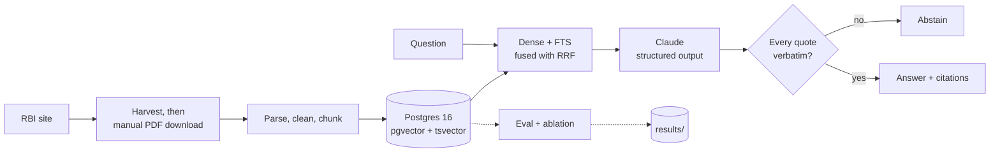

# rbi-rag

Question answering over public **RBI Master Directions**, returning answers
with verifiable citations — circular number, page, and source URL — backed by
a reproducible evaluation suite and an ablation study.

> **Status: all seven phases built. No measured results yet.** The pipeline,
> the evaluation suite, the CI gate, the frontend and the deployment
> configuration are in place and tested. What is missing is a downloaded
> corpus and a human-verified evaluation set, without which there is nothing
> honest to report. The Results section below says `TODO` and is generated
> from `results/*.csv` — no number reaches this README except by being
> measured.

**Live demo:** TODO — deploy with [`infra/`](infra/README.md) and put the URL here.

---

## Why this exists

RBI Master Directions are long, amended often, and cross-reference each other.
A plausible-sounding answer about capital adequacy is worthless if you cannot
check it, so every claim this system makes is tied to a specific page of a
specific circular.

The interesting engineering is not the retrieval. It is the two things the
system **refuses** to do.

**It will not return a citation it cannot verify.** Checking that a cited chunk
was retrieved is the easy half; a model can attach a fluent, confident,
entirely invented sentence to a chunk id it really was shown. So every quote
must appear verbatim in the chunk it names, after whitespace normalisation and
nothing else. A quote that differs by a word is a failed citation, and the
answer is withheld rather than shipped with the bad citation stripped out.

**It will not answer from anything but the retrieved excerpts.** When they do
not support an answer it abstains, and abstention is a distinct state in the
API and the UI rather than an empty string.

Everything else — hybrid retrieval, the ablation, the CI gate — exists to find
out whether those guarantees cost anything worth paying, and to notice when
they stop holding.

## Architecture



Full diagrams, the package graph and the testing seams are in
[docs/architecture.md](docs/architecture.md).

## Results

<!-- BEGIN results (generated by `uv run poe docs` -- do not edit by hand) -->

**TODO** — no measured results yet.

Results need a downloaded corpus and a human-verified evaluation set. Once both exist, run `uv run poe eval`; this section is regenerated from `results/*.csv` by `uv run poe docs` and is never written by hand.

<!-- END results -->

## Quick start

Requires Windows with PowerShell, [uv](https://docs.astral.sh/uv/), and Docker
Desktop with the WSL2 backend.

```powershell
uv sync
Copy-Item .env.example .env   # then set ANTHROPIC_API_KEY
uv run poe db-up
uv run poe lint
uv run poe test
```

```powershell
uv run poe ingest harvest     # catalogue of ~380 Master Directions
uv run poe ingest urls        # the PDFs you need to download by hand
```

RBI serves its PDFs behind a JavaScript bot challenge, which this project does
not work around. Download them through a browser into `data/raw/`, then:

```powershell
uv run poe ingest process
uv run poe index build
uv run poe serve              # http://127.0.0.1:8000/
```

The full path from clone to results table, including the three steps that need
a human, is in [docs/reproduce.md](docs/reproduce.md).

## Tasks

| Task | What it does |
| --- | --- |
| `uv run poe lint` / `fmt` / `test` | ruff, mypy strict on `src/`, pytest |
| `uv run poe test-integration` | needs Postgres (`poe db-up`) |
| `uv run poe test-model` / `test-parity` | downloads models / needs `--extra ml` |
| `uv run poe db-up` / `db-down` / `db-nuke` | manage Postgres |
| `uv run poe ingest harvest` / `urls` / `status` / `process` | acquisition and chunking |
| `uv run poe index migrate` / `build` / `sets` | schema and indexing |
| `uv run poe query "..."` | ranked chunks with per-retriever provenance |
| `uv run poe serve` | the API and frontend |
| `uv run poe eval status` / `draft` / `review` | build the evaluation set |
| `uv run poe eval retrieval` / `eval` | metrics and the 36-arm ablation |
| `uv run poe eval gate` / `snapshot` | the CI regression gate |
| `uv run poe docs` | regenerate the generated parts of this README |

## Key design decisions

Thirty-six are recorded in [DECISIONS.md](DECISIONS.md), with an index at the
top. The ones that shaped the system:

- **[0014](DECISIONS.md#0014--onnxruntime-as-the-embedding-backend-not-sentence-transformers)
  — onnxruntime instead of sentence-transformers.** ~130 MB against ~2.5 GB,
  which is what makes the CI gate affordable. Hand-rolling CLS pooling is a
  real risk, so it is measured against the reference implementation: maximum
  elementwise difference 1.6e-07, cosine similarity 1.00000000.
- **[0016](DECISIONS.md#0016--evaluation-searches-exactly-hnsw-serves-queries)
  — evaluation uses exact kNN, not HNSW.** An approximate index loses recall of
  its own, and folding that into a comparison between retrievers makes it
  indistinguishable from a real effect.
- **[0021](DECISIONS.md#0021--citations-are-validated-at-the-quote-and-the-pipeline-fails-closed)
  — citations are checked at the quote, and the pipeline fails closed.**
- **[0026](DECISIONS.md#0026--gold-evidence-is-labelled-as-spans-not-as-chunk-ids)
  — gold evidence is labelled as spans, not chunk ids.** Chunk ids encode their
  chunking configuration; measured across four chunkings of one document, no id
  was shared by any pair. A chunk-id gold set would have made the ablation
  uncomputable.
- **[0031](DECISIONS.md#0031--postgres-full-text-search-matches-disjunctively)
  — Postgres FTS matches disjunctively.** It did not, and every keyword arm
  scored 0.0 recall on questions whose answers were indexed. The in-memory test
  double disagreed with Postgres on semantics, so the unit suite passed
  throughout.
- **[0033](DECISIONS.md#0033--the-gate-checks-order-sensitive-metrics-not-recall5-alone)
  — the CI gate checks order-sensitive metrics.** Built to gate on recall@5
  alone, it passed a dense retriever ranking by *furthest* vector.

## Limitations

Stated plainly, because a portfolio README that read as though everything were
finished would be the most misleading thing in the repository.

**There are no measured results.** The ablation runs end to end, but on a
fixture corpus its numbers mean nothing. Real results need PDFs and a verified
evaluation set.

**PDF acquisition is manual.** RBI's document host answers scripted clients
with a JavaScript bot challenge, and this project does not circumvent it.
Everything downstream of `data/raw/` is automated and reproducible.

**`robots.txt` could not be read.** RBI returns HTTP 418 for it to every
scripted client tried. Per RFC 9309 a 4xx means no policy is published, so
harvesting proceeds and each run records that no policy was actually read. The
two-second request floor applies regardless.

**Postgres full-text search is not BM25.** `ts_rank_cd` has no document-length
normalisation and no tunable k1/b, so this arm is reported as "FTS" and never
as BM25. The `english` configuration also stems with Snowball, which conflates
regulatory terms a lawyer would distinguish.

**1024-token chunks are truncated when embedded.** `bge-small-en-v1.5` accepts
512, and the tokenizer does not enforce it (measured: 2,000 words encode to
2,000 tokens), so truncation happens silently inside the embedder. Any result
involving 1024-token chunks must report the truncation count beside it.

**Generation metrics are not deterministic.** Responses are cached by content
hash so a re-run replays them; clearing the cache re-samples the model.
Retrieval metrics reproduce exactly.

**Faithfulness depends on an LLM judge**, and is reported next to Cohen's kappa
against hand labels. Until that subset is labelled it reads `TODO`.

**Abstention has no tuned threshold.** The retrieval gate ships disabled; a
threshold chosen before there are labelled unanswerable questions would be a
number nobody measured. Abstention currently rests on the model's own judgement
plus citation validation.

**The CI gate does not measure quality.** It detects change on a fixture
corpus, and it cannot catch a regression inside the embedder, since it replays
committed query vectors.

**The deployment has no TLS and no authentication**, and **the Terraform has
never been applied.** It validates, but validation is not a deployment.

**Section detection falls back to a heuristic.** `section_aware` chunking
prefers the PDF outline, but many RBI PDFs carry no bookmarks, in which case
headings are detected by pattern matching.

**Only public Master Directions are indexed.** Amendments issued as separate
circulars may not be reflected in the text of the parent Direction.

## Project layout

```
src/rbi_rag/   config schemas ingest index retrieve generate api eval
tests/         mirrors src/; fixtures in tests/fixtures/
eval/          evaluation set and the CI gate's fixture snapshot
results/       generated tables — never hand-edited
infra/         Terraform for a free-tier AWS deployment
docs/          architecture and the reproduction runbook
data/          git-ignored; re-creatable
```

Conventions are in [CLAUDE.md](CLAUDE.md).

## License

TODO
