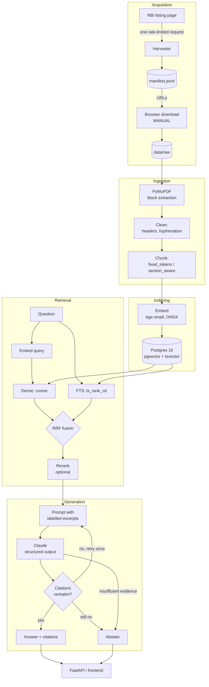
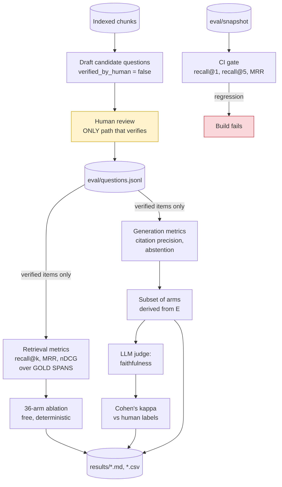

# Architecture

How the system fits together, and why the pieces are shaped the way they are.
Individual tradeoffs are recorded in [DECISIONS.md](../DECISIONS.md); this is
the map.

## The answering path

Two things in that diagram carry most of the project's weight.

**The manual download step** is not an oversight. RBI serves its PDFs behind a
JavaScript bot challenge, and this project does not circumvent it
([0008](../DECISIONS.md#0008--browser-assisted-pdf-acquisition)). Everything
downstream of `data/raw` is automated and reproducible.

**The citation check and the abstention path** are the system. A RAG pipeline
that always answers is easy; one that declines when the evidence is not there,
and that refuses to emit a quote it cannot find in the source, is the thing
worth building
([0021](../DECISIONS.md#0021--citations-are-validated-at-the-quote-and-the-pipeline-fails-closed)).

## The evaluation path

Three properties this layout exists to guarantee:

**Gold evidence is labelled as spans, not chunk ids.** Chunk ids encode their
chunking configuration and share nothing across configurations — measured as
zero overlap between any two. A chunk-id gold set would have been valid for one
arm of the ablation and empty for the other five
([0026](../DECISIONS.md#0026--gold-evidence-is-labelled-as-spans-not-as-chunk-ids)).

**Nothing automated can verify an eval item.** Drafting writes
`verified_by_human=false` and raises if asked to write `true`; only the review
CLI, recording a human's answer, sets it. Every reported metric filters on that
flag.

**The CI gate is a separate thing from measurement.** It runs on a fixture
corpus and detects *change*; it says nothing about quality
([0032](../DECISIONS.md#0032--the-ci-gate-is-a-canary-not-a-quality-measure)).

## Package layout

| Package | Holds | Depends on |
| --- | --- | --- |
| `schemas/` | every shared Pydantic model | nothing in the project |
| `config/` | the only place that reads the environment | `schemas` |
| `ingest/` | harvester, parser, cleaner, chunker | `schemas`, `config` |
| `index/` | migrations, embedding, chunk store | `schemas`, `config` |
| `retrieve/` | dense, FTS, RRF fusion, rerank | `index`, `schemas` |
| `generate/` | prompting, structured output, citation validation | `retrieve`, `index` |
| `api/` | FastAPI app and the frontend page | `generate` |
| `eval/` | metrics, judge, calibration, ablation, CI gate | all of the above |

`schemas/` imports nothing from its siblings, which keeps the dependency graph
acyclic by construction rather than by care
([0002](../DECISIONS.md#0002--a-shared-schemas-package)).

## Seams that exist for testing

Each of these is a protocol with a real implementation and a fake, so the layer
above is testable without a database, a model, or a network:

| Protocol | Real | Fake |
| --- | --- | --- |
| `ChunkStore` | `PostgresChunkStore` | `InMemoryChunkStore` |
| `Embedder` | `OnnxEmbedder` | `FakeEmbedder`, `PrecomputedEmbedder` |
| `Reranker` | `OnnxCrossEncoder` | `FakeReranker` |
| `LLMClient` | `AnthropicClient` | `FakeLLM` |
| `Judge` | `AnthropicJudge` | injected callable |
| `TokenCounter` | `HuggingFaceTokenCounter` | `WhitespaceTokenCounter` |
| `Fetcher` | `LocalFetcher` | — |

One warning earned the hard way: **a fake that behaves differently from the
real thing is not evidence about the real thing.** `InMemoryChunkStore` scored
keyword search disjunctively while Postgres scored it conjunctively, and a
completely broken FTS retriever passed the entire unit suite as a result
([0031](../DECISIONS.md#0031--postgres-full-text-search-matches-disjunctively)).
Keep the two agreeing on semantics.

## Test tiers

| Tier | Needs | Runs in CI |
| --- | --- | --- |
| unit (default) | nothing | yes |
| `integration` | Postgres | the gate job only |
| `model` | HuggingFace download | no |
| `parity` | torch (`--extra ml`) | no |

The default suite is hermetic on purpose: no network, no database, no model
files. A test that quietly reaches the internet is a test that fails for
reasons unrelated to the code.
